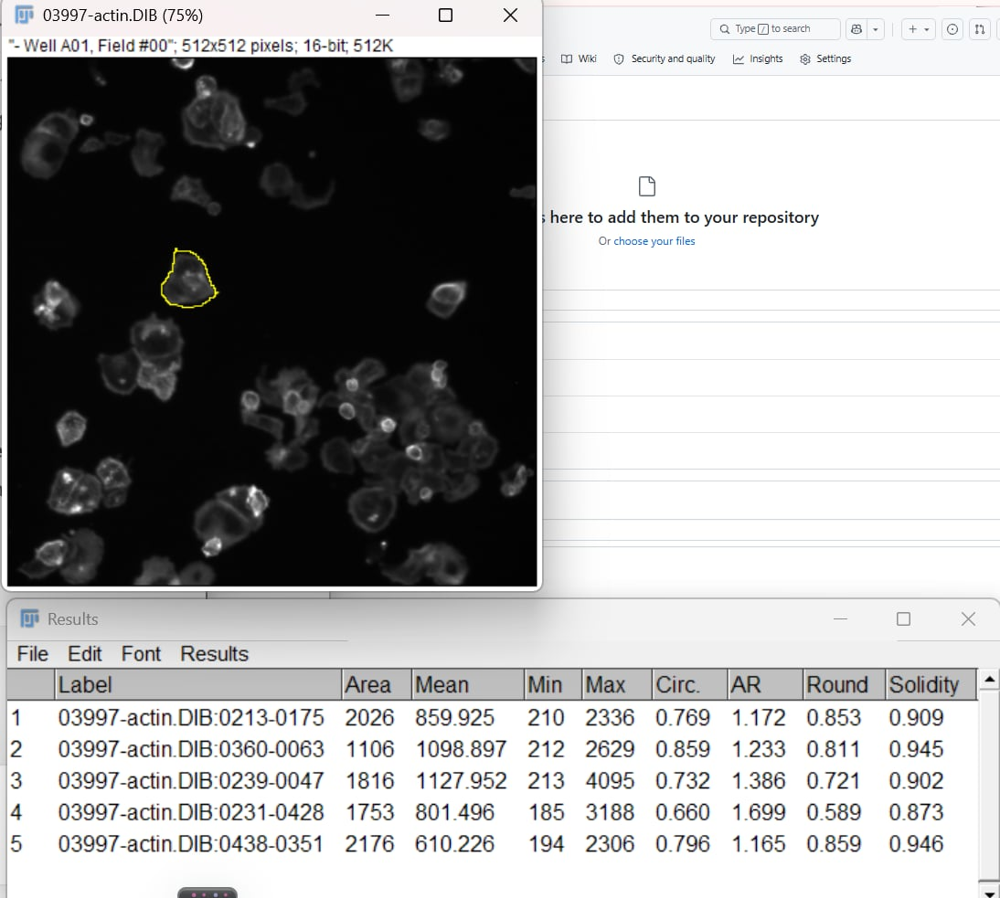
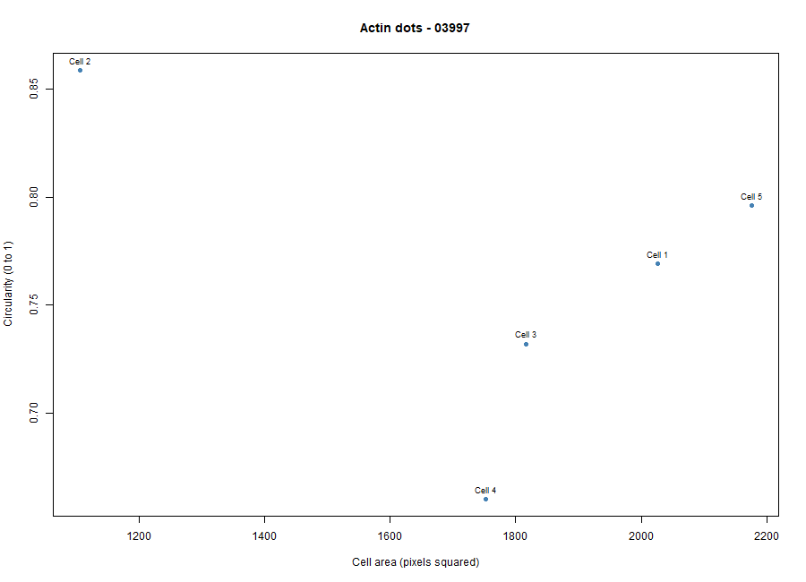
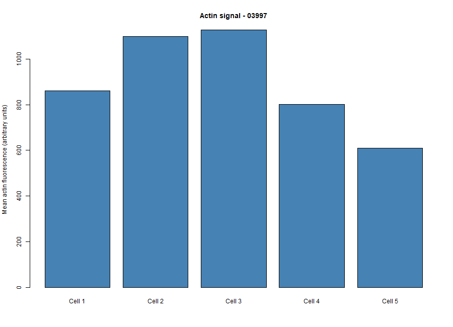

# Cytoskeleton and Cell Morphology – BBBC018

## Student Information

- **Student:** WILLHELM WIEN GALVEZ
- **Chosen phenotype:** Actin dots
- **Image-field ID:** 03997
- **Actin filename:** `03997-actin.DIB`
- **DNA filename:** `03997-DNA.DIB`

## Dataset

This activity used image set **BBBC018v1** from the Broad Bioimage Benchmark Collection (BBBC).

Dataset: https://bbbc.broadinstitute.org/BBBC018

BBBC018 is a fluorescence microscopy image set of human HT29 colon-cancer cells with diverse phenotypes. The actin channel was used to examine F-actin organization and cell morphology, while the DNA channel helped identify nuclei and distinguish neighboring cells. 

## Selected Phenotype

I selected **Actin dots** based on the visible dot-like features in the actin staining pattern of image field 03997. The phenotype classification was based on visual comparison with the phenotype examples provided for the activity.

## Selected Images

The selected image field was **03997**.

- Actin image: `03997-actin.DIB`
- DNA image: `03997-DNA.DIB`

The original DIB images were kept unchanged.

## Fiji Analysis

The `03997-actin.DIB` image was opened in Fiji together with the matching `03997-DNA.DIB` image.

The following measurements were selected in Fiji:

- Area
- Mean gray value
- Shape descriptors
- Circularity
- Aspect ratio
- Display label

Five clearly visible cells were selected using the Freehand Selection tool and measured using Fiji's ROI Manager.

Circularity was used to describe how round the cells were, while aspect ratio was used to describe cell elongation. Mean gray value represented the average actin-channel fluorescence within each selected cell.

The Fiji measurements were saved as:

`data/fiji_results.csv`

## Numerical Results

Five cells were measured from image field 03997.

| Measurement | Result |
|---|---:|
| Phenotype | Actin dots |
| Image-field ID | 03997 |
| Cells measured | 5 |
| Mean cell area | 1775.4 pixels² |
| Mean circularity | 0.7632 |
| Mean aspect ratio | 1.331 |
| Mean actin signal | 899.6992 |

## Figure 1: Measured Cells



This image shows the five cells selected and measured in Fiji using the ROI Manager.

## Figure 2: Area vs. Circularity



This figure shows the relationship between cell area and circularity for the five measured cells.

## Figure 3: Actin Intensity



This figure shows the mean actin fluorescence intensity measured for each of the five cells.

## Questions and Answers

### 1. Which specific phenotype did you choose, and what visible features support that choice?

I chose **Actin dots** because the actin image shows distinct bright dot-like features in the F-actin staining pattern. These visible features support the classification of the selected field as an Actin dots phenotype.

### 2. Were your five cells mostly round or elongated? Refer to your circularity and aspect-ratio results.

The five cells were mostly round rather than strongly elongated. The mean circularity was **0.7632**, while the mean aspect ratio was **1.331**, although one cell had a higher aspect ratio of 1.699, showing some variation in cell shape.

### 3. What role does actin play in maintaining cell shape and in cell movement (Karp Chapter 9)?

Actin filaments are an important part of the cytoskeleton and help maintain cell shape by providing structural support, especially near the cell cortex. Actin also works with other cytoskeletal components and motor proteins to produce changes in cell shape and contribute to cell movement.

### 4. Why can a single fixed fluorescence image NOT show how fast a cell moves?

A single fixed fluorescence image captures cells at only one point in time. It can show cell shape and actin organization, but it cannot determine how fast a cell moves because movement requires observations over time, such as a time-lapse sequence.

## Generated Files

```text
data/
└── fiji_results.csv

figures/
├── measured_cells.png
├── area_vs_circularity.png
└── actin_intensity.png

results/
└── cell_summary.csv
